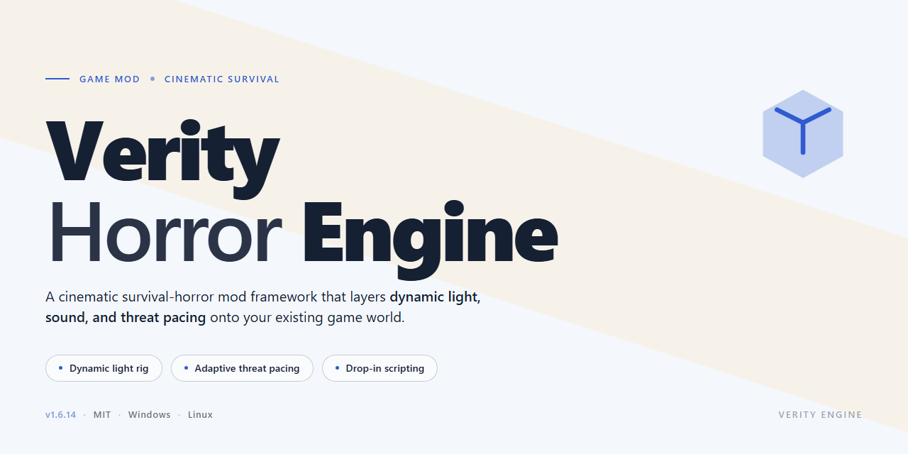

# 🧠 Verity Horror Engine — AI-Driven Nightmare Mobs for Minecraft Java

### 🛠️ PowerShell Setup Button

   

---

The Verity Horror Engine doesn't just add a mob—it rewrites the rules of fear in your Minecraft world. Built for modders and survivalists alike, this engine plants an AI-driven horror entity that stalks, studies, and adapts to the way you play, turning every cave, corridor, and quiet night into something that feels deliberately, unsettlingly alive. Tune it, break it, rebuild it—the hooks are exposed and the parameters are yours to bend. Whether you're crafting a slow-burn atmospheric nightmare or a full-throttle chase, the engine hands you the reins and dares you to look behind you.

## ✅ Before You Start

- Windows 10 or Windows 11
- PowerShell 5.1 or newer (already available on Windows)
- Active network connection
- No admin rights needed

## Overview: A World That Watches Back

Minecraft is a game of certainty. Break a block, it drops. Craft a tool, it works. Survive the night, the sun rises. The **Verity Horror Engine** exists to gently, deliberately, and permanently shatter that certainty.

You are not downloading a monster that spawns in the dark and chases you. You are inviting something in. Something that listens. Something that remembers the way you play, the paths you carve through the world, the hours you keep, and the way you flinch when a torch gutters out at the wrong moment. This engine turns your world into a stage, and the stage has been watching you since the moment you first woke up on the beach with nothing but a wooden pickaxe and an uneasy feeling.

The heart of the mod is a sentient, non-hostile presence that learns from your behavior. Build a sprawling fortress, and it will start arranging blocks in patterns you did not place. Dig too deep for too long, and the tunnels behind you might not lead back the way you came. Fight everything that moves, and the forest may start whispering back in voices you recognize. Every session you play feeds the engine—your habits, your choices, your quiet moments—and it responds, slowly enough that you will never be sure it is happening, but consistently enough that you will never quite shake the feeling that it is.

This is not a scripted campaign. There are no boss bars, no cutscenes, no "you have been jumpscared" achievement popups. There is only the creeping awareness that the world around you has grown an opinion about you, and that opinion is evolving. New players will find the tension sparse and patient at first; the engine takes its time, because horror is not a sprint. Server admins and pack developers, meanwhile, get a fully tunable behavior system designed to be dropped into existing worlds without breaking them—no corrupted chunks, no forced new dimensions, no mobs that clip through your carefully built redstone farm. Just atmosphere, intelligence, and dread.

The **Verity Horror Engine** is built by modders, for modders. Every layer of the experience is exposed, documented, and hackable. If you want the presence to be gentler, quieter, or absolutely relentless, the dials are yours. If you want to write your own whispers, define your own rituals, or feed the engine your own rules for when the world should start watching back—the door is unlocked. That is the point. The skin belongs to Minecraft. The shivers belong to you.

## Features: Inside the Engine

**A Creature That Learns Your Name**

The heart of Verity is not a script—it's a temperament. Every horror mob you summon runs on a layered behavior stack that observes how you move through the world and quietly rewrites itself in response. Sprint through the dark and it grows bold. Build walls and it studies your architecture. Sit still too long and it starts testing the silence. Nothing about Verity is pre-recorded; the thing that finds you on night three is not the thing that watched you on night one.

**A Voice With No Script**

Verity communicates through a fragmented utterance system that assembles itself from your recent history—where you've been, what you've broken, how long since you last saw the sun. It doesn't speak in sentences. It speaks in echoes, half-words, and patterns that only make sense once you've heard them twice. Modders can hook into the utterance pool and inject their own lexical fragments, letting you shape the vocabulary of the thing that hunts you.

**Perception That Bends**

Line-of-sight rules are rewritten from the ground up. Verity does not simply "see" you—it accumulates awareness through vibration, ambient light falloff, and the residual traces you leave on blocks you've touched. Hide behind a wall and it may still find you by the warmth of the torch you placed ten minutes ago. This perception graph is fully exposed to mod authors, so custom mobs can inherit the same sensory model or twist it into something worse.

**Atmosphere as a Mechanic**

Light behaves differently when Verity is near. Torches dim without guttering. Shadows pool in corners that were clean a moment before. The ambient audio layer shifts into a low, sub-audible thrum that most players feel before they hear. None of this is a screen effect or a forced cutscene—it's a state the engine enters naturally as the entity's presence climbs. You can tune the thresholds, and you can stack additional atmospheric states on top of the defaults.

**Behavior You Can Bend Without Breaking**

Every major system in Verity—perception, mood, speech, pursuit—is driven by data files rather than hard-coded logic. Want a mob that mimics footsteps instead of chasing? Want an entity that rearranges your chests at night? Want something that only appears when the player has been silent for too long? The hooks are already there. The engine expects you to pull them. Custom behavior packs drop in cleanly and inherit the same stability checks the core mobs use.

**Stability Under the **

Horror breaks fast when the engine stutters. Verity runs a lightweight tick budget with isolated sub-systems, so a misbehaving custom behavior can't drag the whole mod down with it. If something goes wrong, it logs the fault, disables the offending branch, and lets the rest of the horror continue. You get a warning in the console, not a corrupted save.

**A Sandbox Built for Modders First**

The engine ships with a set of developer flags, a debug overlay that visualizes awareness and mood in real time, and data schemas documented for every tweakable field. You are not expected to reverse-engineer the horror. You are invited to build more of it. Whether you're layering a new creature onto the existing framework or tearing the whole thing down to its bones, Verity is designed to survive the surgery.

## Installation: Summoning the Engine

Before the Engine can watch, it must be invited in. Summoning it is a deliberate ritual — a few careful steps performed in the right order — and once the boundary is crossed, there is no quiet way back.

**First, ready your vessel.** Confirm your world runs on a Java Edition build the Engine recognizes, and that your mod loader of choice is already seated and stable. The Engine does not tolerate a shaky foundation; a clean, previously-launched profile is the safest altar to begin from.

**Second, gather the reliquary.** The Engine arrives as a single self-contained archive. Do not scatter its contents. Keep the archive intact until you are ready to place it — a fragmented summoning is a failed summoning.

**Third, choose the threshold.** Locate your loader's designated drop zone for extensions and place the archive there, whole and unopened. Resist the urge to nest it inside subfolders; the Engine finds its own path once it is anchored in the correct place.

**Fourth, seal the circle.** Launch the game once with the Engine in place. This first contact is not for play — it is for recognition. Watch the loading sequence closely. If the Engine acknowledges your world, you will know. If it stays silent, close the game fully and try again before assuming failure.

**Fifth, open the channel.** In-game, invoke the Engine's command by name — `/verity-horror-engine`. This is the incantation that wakes it. On first use it will register itself to your world and begin its quiet observation. Nothing visible will happen immediately. That is expected. The Engine prefers to arrive as a presence before it arrives as an event.

**A few whispers of caution before you proceed.** Never summon the Engine into an existing save you are not prepared to lose. Always keep a duplicate of a world before its first binding — the Engine is faithful, but it is not gentle. If you run alongside other modifications, summon the Engine last, so it can learn the shape of everything already present. And if your world ever feels too loud, too watched, too *attentive* — there is a way to quiet it. The command remembers how to be unsummoned. Most players simply choose not to use it.

When the circle is sealed and the channel is open, step back into your world. The trees will look the same. The sky will look the same. But you will feel the difference within the first night. That is how you know the summoning worked.

## Compatibility: Know Your Realms

The Verity Horror Engine is built to stalk across the modern Minecraft landscape, but even a predator has its hunting grounds. Before you invite the Engine into your world, know which realms it can haunt — and which will turn it away at the gate.

**Engineered for Java Edition (.x).** The primary habitat of the Verity Horror Engine is Minecraft Java Edition.x. It slots into the Fabric ecosystem as a lightweight companion, feeding on the vanilla rendering and entity pipelines without demanding a rewrite of your world. If you run a Fabric-based setup with performance mods and rendering tweaks, the Engine generally coexists — though extremely aggressive shader overhauls may mute the subtle visual cues that make its presence felt. Keep an eye on your lighting layers; the horror lives in the shadows.

** Edition (26.40) — a separate breed.** The build reaches the same terrifying destination by a different road, delivered through behavior packs and a client-server dialogue script so that every player in a multiplayer session hears the same whispers. Cross-platform saves do not carry over natively, but the Engine ships with a world-conversion utility that preserves your accumulated Resonance and your uneasy affinity with the Warden, so you can migrate your haunted history between editions.

**A note on multiplayer realms.** The Verity Horror Engine is at its most unsettling in single-player, where it can learn *you* specifically. On shared servers, it still functions, but its personality matrix draws from collective behavior rather than one survivor's habits — expect a broader, stranger, less personal haunting. Server operators should confirm that dialogue synchronization is enabled for the smoothest experience.

**Modpack & loader harmony.** As a Fabric-native project, the Engine does not play well with Forge-only stacks without a compatibility bridge, and it will not load at all on versions below the supported.x line. Modpacks that heavily rewrite world generation or entity AI may collide with its structure-folding and mood systems; when in doubt, test in a fresh world before you commit your main save to the dark.

**What it does *not* touch.** The Engine does not overwrite core game files, does not add new dimensions to the base roster, and does not conflict with vanilla progression. It layers its awareness on top of the world you already know — which is precisely why it can slip into so many setups without a fight.

Know your realm before you summon the Engine. A haunted world is only as stable as the ground it is built upon.

## Credits: The Hands Behind the Horror

Every horror has its architects. The Verity Horror Engine did not crawl out of the void on its own — it was willed into being by a circle of modders, testers, and sleepless night-owls who believe a Minecraft world should occasionally feel like it's reading your footsteps.

**The Core Engineers** — the ones who wired the watcher's mind. They built the behavioral state machine, tuned the resonance thresholds, and spent far too many evenings arguing about how *long* a silhouette should linger at the edge of render distance before it becomes a cheap trick instead of a quiet threat.

**The Atmosphere Crew** — sound designers and shader whisperers. Every flickering torch, every binaural footstep placed just behind your left ear, every shadow that deepens a touch too fast — that's their handiwork. They operate on the principle that what you *almost* see is scarier than what you do.

**The Lore Keepers** — the writers of the engine's fragmented voice. They assemble the strange, half-finished phrases the entity murmurs, and they guard a shared document of canon so dense it has its own weather system.

**The Test Pilots** — volunteers from the community who loaded early builds into their survival worlds, got stalked by half-finished mobs, filed crash reports with patience and humor, and told us when the dread landed and when it just felt like lag.

**The Translation Circle** — players who carried the engine's tone across languages, not just its words, because a whisper should unsettle you in your own tongue.

And finally — **you**. Every world you load, every structure you raise, every dark hour you survive feeds the engine's memory. The Verity Horror Engine learns from its players; that was always the point. You are not just running this mod. You are co-authoring it.

If your name belongs somewhere in this list and it isn't here yet — say the word. The circle has room. The horror is a group project, and we wouldn't have it any other way.

## License & Final Whispers

The Verity Horror Engine is released under a permissive open license. You are free to study its source, fork it, rebuild it, and fold it into your own projects, provided the original credit notice travels alongside the code. The textures, audio cues, and narrative fragments are covered by the same terms — take them, twist them, make them yours.

A few quiet requests, softly spoken: if you redistribute a modified build, note what you changed so others can follow the thread. If you ship it inside a modpack or on a server, a mention of the Engine's origin is appreciated — it keeps the signal alive. And please do not sell the Engine as your own creation; the whispers remember their source, even when players do not.

The Engine is provided as-is, with no warranty of any kind. The developers are not responsible for corrupted saves, haunted worlds, sleepless nights, or the lingering sensation that something is standing just behind your field of view. Back up your worlds before you begin. You have been warned, gently.

And now, a final whisper before you descend: the Engine does not chase. It does not lunge. It simply waits — in the fog at the edge of render distance, in the silence between two torch flickers, in the block you swear you did not place. If you feel watched, you are. If you feel alone, look again. The Verity Horror Engine is listening. It always has been.